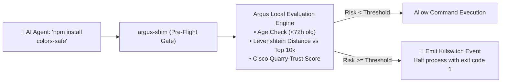

# Recipe: Pre-Flight Dependency Slopsquatting Interception

> **Use Case ID:** `ARG-UC-01`  
> **Target Audience:** Developers, Agent Operators, DevSecOps Engineers  
> **Platform Mechanism:** Pre-Flight Shell Interception & Heuristic Scorer  

---

## 1. Problem Statement

Autonomous coding agents (Claude Code, Cursor, Aider) often hallucinate package names when synthesizing imports (e.g. recommending `colors-safe` instead of `colors`, or `request-promise-native-v2`). Attackers actively monitor LLM output, register these hallucinated package names ("slopsquatting"), and upload malicious payloads that steal developer credentials upon installation.

---

## 2. When to Use This

Use **Pre-Flight Slopsquat Interception** whenever an agent or developer executes package installation commands (`npm install`, `pip install`, `cargo add`, `go get`). Argus intercepts the invocation *before* DNS resolution or package download occurs.

---

## 3. Architecture & Dataflow



---

## 4. Prerequisites

1. **Argus Installed:** `brew install bonjoski/tap/argus`.
2. **Shims Active:** `argus install` to place lightweight shims on `$PATH`.

---

## 5. Step-by-Step Recipe

### Step 1: Run Command via Argus Explicitly
```bash
argus exec -- npm install lodash
```
Output:
```text
[argus] Evaluated 1 package: 'lodash'
[argus] Levenshtein: EXACT_MATCH (Canonical: lodash) | Age: >10y | Trust: HIGH
[argus] Risk Score: 0.00 -> APPROVED
```

### Step 2: Test Slopsquatting Interception
Attempting to install a flagged or typosquatted package:
```bash
argus exec -- npm install colors-safe
```
Output:
```text
[argus] 🚨 SECURITY ALERT: High-risk package intercepted: 'colors-safe'
[argus] Slopsquat Pattern: Levenshtein distance 5 from canonical 'colors'
[argus] Package Age: 18 hours old (HIGH_RISK_NEW_RELEASE)
[argus] Execution HALTED before network download. Exit code 1.
```

---

## 6. Verification & Expected Output

Verify that your system shell intercepts package managers transparently:
```bash
which npm
```
Points to `~/.argus/bin/npm` (which wraps native `npm` transparently).

---

## 7. Security Invariants & Blast Radius

- **Pre-Network Interception:** The target package is blocked before the package manager initiates HTTP GET requests or DNS resolution.
- **Fail-Closed on Unparseable Commands:** If an agent obfuscates command arguments (`npm install $(echo bG9kYXNo | base64 -d)`), Argus fails closed.

---

## 8. Troubleshooting & Common Pitfalls

- **Issue:** Legitimate internal company package flagged as new/untrusted.  
  **Remediation:** Add company scope to local allowlist:
  ```bash
  argus config add-allowlist "@mycorp/*"
  ```
