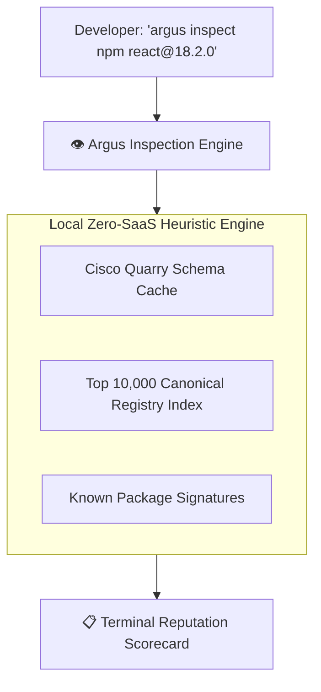

# Recipe: Offline Package Reputation Inspection

> **Use Case ID:** `ARG-UC-02`  
> **Target Audience:** Security Analysts, Package Reviewers, CI/CD Gateways  
> **Platform Mechanism:** Cisco Project Quarry Local Runtime  

---

## 1. Problem Statement

Before committing a new dependency to a project lockfile, developers need to inspect its authenticity:
- When was the package published?
- How fast are versions being released?
- Does it resemble a high-profile package name?
- Has its signing key changed?

Doing this manually across multiple registries requires opening multiple web browsers and inspecting raw metadata.

---

## 2. When to Use This

Use **`argus inspect`** to audit any package name and version across npm, PyPI, Crates.io, and Go modules. Argus queries its local Quarry reputation cache and canonical name registry to output a comprehensive trust report.

---

## 3. Architecture & Dataflow



---

## 4. Prerequisites

1. **Argus CLI:** Version 1.0+ on `$PATH`.
2. **Local Cache:** Initialized via `argus cache sync` (or ambient).

---

## 5. Step-by-Step Recipe

### Step 1: Inspect a Package
```bash
argus inspect npm express@4.18.2
```
Expected output:
```text
📦 Argus Package Inspection: npm/express@4.18.2
─────────────────────────────────────────────────────────────────
Canonical Status:  PRIMARY CANONICAL (Rank #4 npm)
Publication Age:   >12 years (Initial: 2010-12-29)
Release Velocity:  STABLE (Last release: 6 months ago)
Maintainer Count:  4 verified maintainers
Quarry Trust:      0.99 (EXEMPLARY)
Overall Risk:      0.01 (LOW / SAFE TO USE)
─────────────────────────────────────────────────────────────────
```

### Step 2: Explain Why a Package Was Blocked
If a package failed pre-flight checks:
```bash
argus explain colors-safe
```
Shows exact breakdown of Levenshtein calculations, author domain age, and heuristic triggers.

---

## 6. Verification & Expected Output

Run a self-diagnostic check:
```bash
argus doctor
```
Confirms Quarry database integrity, heuristic cache status, and local socket readiness.

---

## 7. Security Invariants & Blast Radius

- **100% Local Heuristics:** Zero telemetry or package queries leak to commercial threat intelligence SaaS platforms.
- **Deterministic Scoring:** Identical package metadata produces identical risk scores across all developer machines.

---

## 8. Troubleshooting & Common Pitfalls

- **Issue:** `argus cache sync` fails when offline.  
  **Remediation:** Argus operates in pure offline mode using embedded fallback registries. Network sync is strictly optional.
