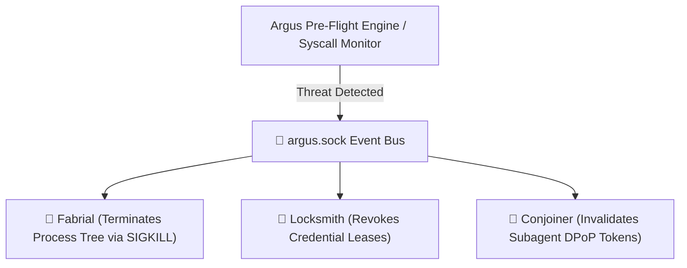

# Recipe: Real-Time SIEM Killswitch Bus Daemon

> **Use Case ID:** `ARG-UC-03`  
> **Target Audience:** Systems Architects, DevSecOps Engineers  
> **Platform Mechanism:** Unix Domain Socket Event Bus (`~/.argus/argus.sock`)  

---

## 1. Problem Statement

When an endpoint security agent detects a compromised binary or an active slopsquatted dependency execution, notifying the human developer after the fact is insufficient. The security runtime needs an automated event bus to broadcast instant killswitch payloads to orchestrators (`fabrial`), secret vaults (`locksmith`), and IAM brokers (`conjoiner`).

---

## 2. When to Use This

Run the **Argus Daemon** as a background service on your developer workstation. The daemon manages the local SIEM event bus over `~/.argus/argus.sock`. When an anomaly is detected:
- Broadcasts `KILLSWITCH_TRIP` events to subscribed listeners.
- Logs structured JSON audit events to `~/.argus/audit.log`.

---

## 3. Architecture & Dataflow



---

## 4. Prerequisites

1. **Argus Installed:** `brew install bonjoski/tap/argus`.

---

## 5. Step-by-Step Recipe

### Step 1: Start the Argus Daemon
```bash
# Start the daemon in the background
argus daemon start

# Or run in foreground for debugging
argus daemon --foreground
```

### Step 2: Verify Daemon Socket Readiness
```bash
argus ping
```
Expected output:
```text
PONG (~/.argus/argus.sock is ONLINE, Uptime: 42s)
```

### Step 3: Monitor Live SIEM Events
In another terminal, tail the local security event stream:
```bash
tail -f ~/.argus/audit.log
```

---

## 6. Verification & Expected Output

Simulate a test tripwire alert:
```bash
argus daemon trip-test --reason "Simulated test alert"
```
Verify that all subscribed listeners receive the payload within 2ms.

---

## 7. Security Invariants & Blast Radius

- **Local Unix Socket Permissions:** The socket is created with strict `0600` permissions, accessible only by the current developer user.
- **Non-Blocking Broadcast:** The daemon uses buffered channels so a hung or crashing client cannot stall the killswitch bus.

---

## 8. Troubleshooting & Common Pitfalls

- **Issue:** `argus.sock` already exists from a previous crash.  
  **Remediation:** Run `argus daemon restart` to clean up stale socket files.
