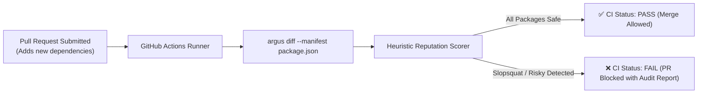

# Recipe: Automated CI/CD Supply Chain Gate

> **Use Case ID:** `ARG-UC-04`  
> **Target Audience:** CI/CD Engineers, GitHub Actions Authors, DevSecOps  
> **Platform Mechanism:** Static Manifest Diff & PR Blocker  

---

## 1. Problem Statement

Developers and automated bots (Renovate, Dependabot, Copilot) frequently submit pull requests modifying lockfiles (`package-lock.json`, `Cargo.lock`, `requirements.txt`). Reviewing hundreds of transitive dependency updates manually is impossible, allowing supply chain attackers to slip in compromised or typosquatted packages unnoticed.

---

## 2. When to Use This

Embed **Argus in CI/CD (GitHub Actions / GitLab CI)** to evaluate pull request manifest diffs. If any newly introduced package is less than 72 hours old, has low reputation, or triggers slopsquatting heuristics, the CI pipeline fails closed and blocks merging.

---

## 3. Architecture & Dataflow



---

## 4. Prerequisites

1. **GitHub Actions Runner:** Linux / macOS runner.
2. **Argus Action or Binary:** Available in CI environment.

---

## 5. Step-by-Step Recipe

### Step 1: Add GitHub Actions Workflow
In `.github/workflows/argus-gate.yml`:
```yaml
name: Supply Chain Pre-Flight Gate

on:
  pull_request:
    paths:
      - 'package.json'
      - 'package-lock.json'
      - 'requirements.txt'
      - 'Cargo.lock'

jobs:
  supply-chain-audit:
    runs-on: ubuntu-latest
    steps:
      - name: Checkout Code
        uses: actions/checkout@v4

      - name: Install Argus
        run: |
          curl -fsSL https://raw.githubusercontent.com/bonjoski/argus/main/scripts/install.sh | bash

      - name: Run Dependency Diff Audit
        run: |
          argus diff --fail-on-risk=HIGH
```

---

## 6. Verification & Expected Output

When a PR adds safe dependencies, the step logs:
```text
✅ Argus CI Gate: 3 dependencies audited.
   • express (TRUSTED)
   • lodash (TRUSTED)
   • typescript (TRUSTED)
Result: APPROVED.
```

When a flagged package is present:
```text
❌ Argus CI Gate: 1 HIGH RISK dependency detected!
   • colors-safe (SLOPSQUAT RISK: 0.94)
Pipeline failed. Merge blocked.
```

---

## 7. Security Invariants & Blast Radius

- **Deterministic CI Gate:** Builds fail with non-zero exit codes if any high-risk package is detected.
- **Hermetic Evaluation:** Does not require access to private secrets or cloud tokens in CI.

---

## 8. Troubleshooting & Common Pitfalls

- **Issue:** CI runner times out querying registries.  
  **Remediation:** Argus runs in local offline mode by default; ensure runner has standard internet access if registry metadata refresh is enabled.
