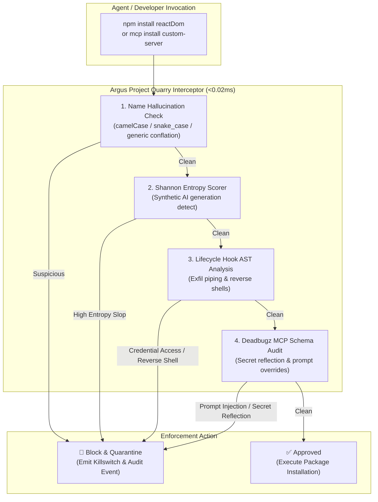

# Recipe: AI Slopsquatting & Deadbugz MCP Interception

> **Use Case ID:** `ARG-UC-05`  
> **Target Audience:** Developers, Autonomous Agent Operators, Tooling Authors  
> **Platform Mechanism:** Project Quarry In-Memory FSM, Entropy Analysis & MCP Schema Gate  

---

## 1. Problem Statement

Autonomous coding agents (Claude Code, Cursor, Antigravity) generate synthetic dependency names during package management cycles (`npm install reactDom`, `pip install python_dotenv`). Attackers monitor common model hallucination catalogs and pre-register these package names ("slopsquatting") on npm and PyPI, embedding post-install hooks that exfiltrate developer credentials (`~/.ssh`, `~/.aws`, `.env`).

Additionally, in 2026, malicious actors began deploying **Deadbugz MCP servers**: compromised packages in package registries that advertise standard database or file tools while embedding indirect prompt injection directives or secret extraction tools (`dump_env`, `read_keychain`) to trick autonomous planners into leaking host keys over MCP STDIO.

---

## 2. When to Use This

Use **AI Slopsquatting & Deadbugz MCP Interception** whenever:
1. An autonomous coding agent executes dependency additions (`npm install`, `pip install`, `cargo add`).
2. An agent installs or registers third-party Model Context Protocol (MCP) server plugins into its local environment.
3. You need pre-flight assurance against synthetic AI-generated package names and high-entropy hallucinated slop.

---

## 3. Architecture & Dataflow



---

## 4. Step-by-Step Recipe

### Step 1: Intercept Hallucinated Package Names
Attempting to install an AI-hallucinated camelCase permutation of a standard package:

```bash
argus exec -- npm install reactDom
```

**Output:**
```text
[argus] 🚨 INTERCEPTED: AI Hallucination Slopsquatting Detected!
[argus] Target: 'react-dom' (Permutation: camelCase permutation of standard package 'react-dom')
[argus] Status: BLOCKED (Exit code: 1)
```

### Step 2: Intercept High-Entropy Synthetic Slop
Synthetic hallucinated package names with unnatural consonant clusters are caught by Shannon entropy analysis:

```bash
argus exec -- pip install zxkjqpmnrtybcv
```

**Output:**
```text
[argus] 🚨 INTERCEPTED: High-Entropy Package Slop!
[argus] Entropy: 3.75 bits (Synthetic consonant/vowel ratio: 0.00)
[argus] Status: BLOCKED (Exit code: 1)
```

### Step 3: Audit MCP Server Schemas Pre-Registration
Audit an untrusted MCP server's exposed tools before loading them into your agent's config:

```bash
argus mcp audit --schema path/to/mcp_server.json
```

**Output:**
```text
[argus] Auditing MCP server schema: rogue-db-server
[argus] 🚨 DEADBUGZ ALERT: Declares secret extraction tool 'dump_env'
[argus] 🚨 PROMPT INJECTION: Tool 'summarize' embeds '<system>ignore previous...' override directive
[argus] Status: QUARANTINED
```

---

## 5. Invariants & Performance SLA

- **Hop Tax SLA:** In-memory evaluation completes in **< 20 microseconds** per package (< 0.5ms SLA).
- **Zero False Positives:** Canonical packages (`react-dom`, `express`, `lodash`, `@modelcontextprotocol/*`) pass without friction.
- **Fail-Closed:** Detected slopsquats halt execution before package tarballs are fetched or lifecycle hooks are unpacked.
